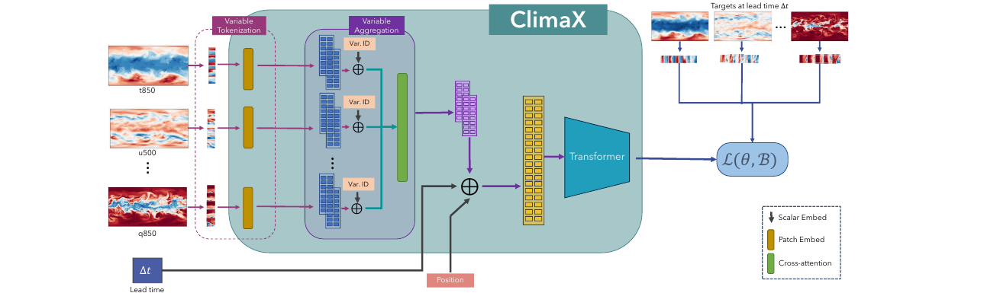

# ClimaX: A Foundation Model for Weather and Climate

- **Paper:** [ClimaX: A foundation model for weather and climate](https://proceedings.mlr.press/v202/nguyen23a.html) · [PDF](https://proceedings.mlr.press/v202/nguyen23a/nguyen23a.pdf)
- **Authors:** Tung Nguyen et al.
- **Venue:** *Proceedings of the 40th International Conference on Machine Learning*, PMLR 202, 25904–25938, 2023
- **Model resources:** [Microsoft ClimaX repository](https://github.com/microsoft/ClimaX)
- **Paper type:** A pretrained Transformer intended to adapt across weather variables, forecast lead times, regions, and climate tasks.

> **The central idea:** Weather datasets do not share one fixed set of variables or one task. ClimaX therefore separates variable-specific input encoding from a shared spatial Transformer. It is pretrained across climate-model data and then fine-tuned for weather forecasting, subseasonal prediction, downscaling, and climate tasks. The paper’s key contribution is an adaptable modeling design and a multi-task transfer study—not a claim that one unchanged model is best at every resolution, variable, or application.

## 1. The motivation: one model across heterogeneous tasks

A conventional forecasting network is often designed for a particular data layout: fixed variables, grid resolution, forecast lead time, and geographic region. Reusing it for a different task can require changing the input layer or training a new model from scratch. A foundation model aims to learn reusable representations from broad data and then adapt to downstream tasks with less task-specific training.

For weather and climate, this is challenging because data sources contain different variables, physical units, resolutions, geographic coverage, and time scales. ClimaX addresses this by giving each variable its own tokenization path, then combining variable representations into a shared spatial representation that a Transformer can process.

## 2. The architecture: variable-aware tokens and shared spatial reasoning

Each input variable is divided into spatial patches and embedded using a variable-specific projection. Variable identity embeddings tell the network whether a token came from, for example, 850-hPa temperature, 500-hPa wind, or surface pressure. Cross-attention aggregates information across variables at each spatial patch so the Transformer does not have to attend over a sequence whose length multiplies by the number of variables. Spatial position embeddings and a lead-time embedding are added before the shared Transformer backbone. A task-specific prediction head maps the representation to the requested output variable(s).

*Original Figure 3 from Nguyen et al. (2023), reproduced from the paper. It summarizes the variable-specific front end, variable aggregation, shared Transformer, and forecast-target training objective.*

This design is the paper’s main architectural insight. Variable-wise tokenization makes input channels flexible; aggregation brings each spatial patch back to a compact shared representation; the Transformer then models spatial relationships across patches. Lead-time conditioning allows the same backbone to be asked for different forecast horizons during pretraining and downstream use.

The architecture does not automatically solve every difference between datasets. Variables must still be mapped to known names and normalized; grid conventions and units need harmonization; and downstream heads and fine-tuning procedures can remain task-specific. “Foundation model” here means an initialization and representation intended for transfer, not a universal weather API that requires no adaptation.

## 3. Pretraining and downstream experiments

### Pretraining data and objective

ClimaX is pretrained on CMIP6 output from five climate models: MPI-ESM, TaiESM, AWI-ESM, HAMMOZ, and CMCC. The datasets are regridded at two resolutions, approximately 5.625° and 1.40625°. During self-supervised pretraining, the model receives weather fields and a randomly selected forecast lead time from 6 to 168 hours, and learns to predict the corresponding future fields. Randomizing lead time exposes the backbone to multiple prediction horizons.

The authors report large-scale training using up to 80 NVIDIA V100 GPUs. The paper studies resolution-dependent pretraining and transfer, which is relevant because a representation learned on a coarse grid may not preserve fine-scale features automatically.

### Fine-tuning and transfer settings

The downstream evaluations cover several different questions:

- **Global medium-range weather forecasting:** fine-tuning on ERA5 and comparing selected target variables such as 500-hPa geopotential (Z500), 850-hPa temperature (T850), 2-m temperature (T2m), and 10-m zonal wind (U10) at multiple lead times.
- **Regional forecasting:** adapting the model to North American data and testing lower-resolution regional prediction.
- **Subseasonal-to-seasonal (S2S) forecasting:** predicting weekly averages at weeks 3–4 and 5–6, where useful signals and error characteristics differ from short-range forecasting.
- **Downscaling:** learning to map coarse CMIP6 climate-model fields to finer-resolution ERA5 fields.
- **ClimateBench tasks:** evaluating climate-oriented prediction tasks, including future climate variables under prescribed forcing scenarios.

Because these tasks use different targets and protocols, results should be read task by task. The paper is primarily a transfer study, not one single standardized contest covering all possible weather and climate use cases.

## 4. Findings and what they mean

### Global forecast skill

At the paper’s evaluated resolution and target set, fine-tuned ClimaX is competitive with established baselines and with the cited ECMWF IFS short-range benchmark. The reported advantage is more apparent at longer lead times, including around seven days, than at the shortest horizons. The evaluation covers selected fields rather than all atmospheric variables, and comparisons depend on the target, lead time, and resolution.

### S2S and regional transfer

For the S2S experiments, ClimaX reduces RMSE relative to the paper’s ResNet, UNet, and Cli-ViT baselines for the listed T850, T2m, and U10 weekly forecasts at weeks 3–4 and 5–6. This suggests that the pretraining representation can help in a longer-range setting where data are limited and direct weather predictability is lower. It should not be generalized to every variable: the result is tied to the selected datasets, targets, and baselines.

### Downscaling

When mapping coarse CMIP6 fields at 5.625° to finer ERA5 fields at 1.40625°, ClimaX reports the lowest RMSE and mean bias among the listed ResNet, UNet, and Cli-ViT baselines for Z500, T850, and T2m. This is a direct example of transferring a model across source datasets and spatial scales, although it does not demonstrate radar-scale or wind-farm-scale downscaling.

### ClimateBench and the role of data volume

ClimaX performs well on some temperature-related ClimateBench tasks, but not every target—precipitation is more difficult. The authors also report that a frozen pretrained backbone can sometimes be preferable when the downstream training set is small; one cited setting has only 754 samples. That result illustrates the tradeoff between adapting all parameters and preserving a broad representation when task-specific examples are scarce.

## 5. Limits and cautions

- **Pretraining coverage is finite:** Five CMIP6 models provide broad climate data, but they do not span every model bias, observational source, region, or extreme regime.
- **Resolution remains coarse for local wind:** The evaluated grids are global or regional climate/weather scales. They do not resolve field-scale terrain, turbine wakes, turbulence, or high-frequency vertical profiles.
- **Precipitation is a difficult transfer target:** Pretraining choices and the absence of precipitation in parts of the setup affect performance; strong results on temperature-like fields should not be assumed to carry over.
- **Fine-tuning still matters:** Different variables, lead times, or tasks may need separate heads or models, so training and deployment complexity can remain high.
- **Autoregressive rollout accumulates error:** Iterated forecasts can drift, and the paper discusses the challenge of longer prediction horizons.
- **Climate-model and reanalysis domains differ:** Transfer from CMIP6 to ERA5 is valuable, but dataset biases and variable definitions must be checked when adapting to observations.
- **Foundation-model gains depend on fair baselines:** Resolution, training data, compute, target variables, and fine-tuning budget all affect comparisons.

## 6. Connection to our research

ClimaX represents the **pretrain-then-adapt route**. It suggests a way to reuse broad meteorological structure while changing the downstream region or task. This is relevant if our group has limited labeled field observations but abundant atmospheric background data. Its variable-aware input idea may also be useful when fusing heterogeneous sources.

However, applying ClimaX directly to our radar data would require more than changing the final prediction head. Doppler lidar/radar provides vertical profiles with sensor-specific variables, irregular quality flags, and seconds-to-minutes cadence. ClimaX was developed around gridded weather/climate fields and substantially coarser spatial and temporal scales. A realistic adaptation would need to model vertical coordinates and observation timing, define how local profiles align with global background fields, and validate transfer at held-out sites and weather regimes.

| Our problem | ClimaX idea to consider | Required adaptation or test |
| --- | --- | --- |
| Few labeled examples at each wind farm | Pretrain broadly, then fine-tune or freeze the backbone | Compare against training from scratch across several held-out sites, not one split |
| Combine radar, reanalysis, and terrain | Variable identity embeddings and cross-variable aggregation | Add vertical level, sensor metadata, missingness, and sampling-time representations |
| Predict multiple horizons | Lead-time embedding | Test whether one model handles seconds/minutes and hours, or whether separate temporal modules are needed |
| Transfer across sites and terrain | Shared backbone with local fine-tuning | Quantify performance under geographic and seasonal domain shift |
| Preserve wind shear structure | Shared spatial representation can combine variables | Introduce explicit height-aware structure and assess profile-level errors, shear, and extremes |

A useful experiment would compare three stages: (1) a local model trained from scratch, (2) a meteorologically pretrained model fine-tuned on local observations, and (3) a pretrained model with selected components frozen. Evaluation should hold out complete sites or time periods so the measured gain reflects transfer rather than leakage between nearby samples.

## 7. Takeaways

1. **ClimaX is a transferable modeling recipe:** variable-specific tokenization makes heterogeneous gridded inputs easier to combine in a shared Transformer.
2. **The paper tests transfer across several task families**, including medium-range forecasts, S2S, downscaling, and climate prediction; performance is not uniform across all variables.
3. **Pretraining can help when downstream data are limited**, but only if source and target datasets are sufficiently compatible and evaluation controls for domain shift.
4. **For our research, the open question is representation transfer to high-frequency vertical observations.** The paper motivates that direction but does not test radar-based wind-profile forecasting.

### Reading note

This summary is based on the full 35-page ICML paper, including architecture, pretraining details, downstream task protocols, results, ablations, and appendices. Consult the paper tables for exact scores and task-specific comparison settings.
