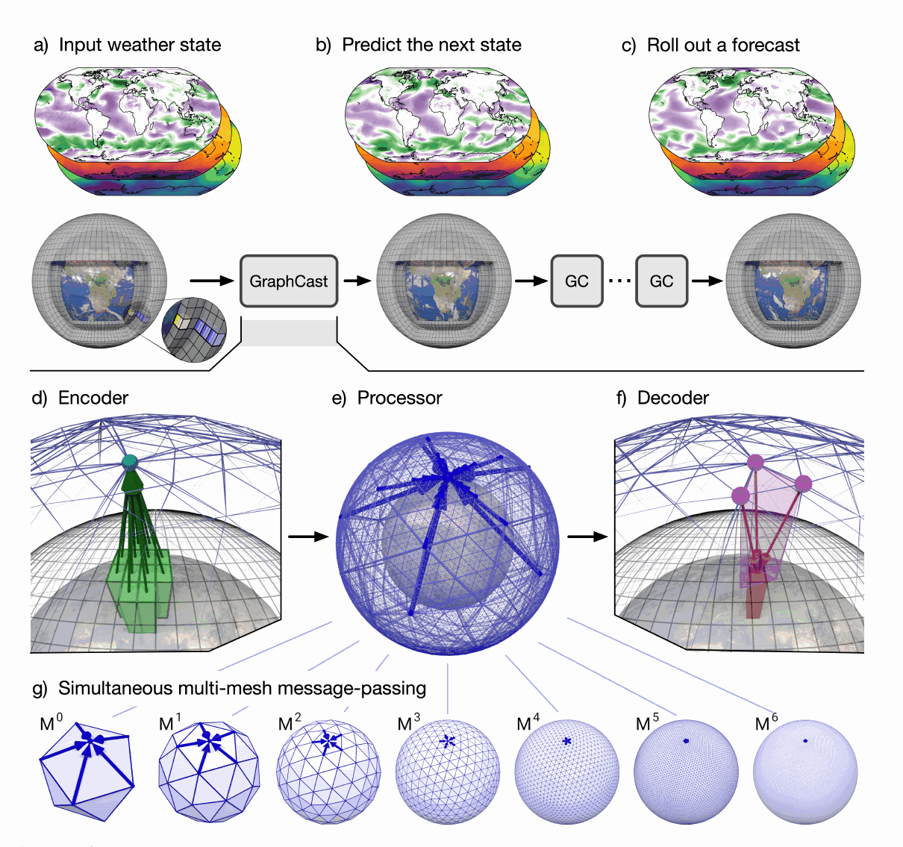

# Learning Skillful Medium-Range Global Weather Forecasting (GraphCast)

- **Paper:** [Learning skillful medium-range global weather forecasting](https://doi.org/10.1126/science.adi2336) · [Full manuscript and supplement](https://arxiv.org/abs/2212.12794)
- **Authors:** Rémi Lam et al.
- **Venue:** *Science*, 382(6677), 1416–1421, 2023
- **Model resources:** [Google DeepMind GraphCast repository](https://github.com/google-deepmind/graphcast)
- **Paper type:** A global, deterministic machine-learning weather forecast model, evaluated against ECMWF operational forecasts.

> **The central idea:** GraphCast learns a six-hour weather-state transition on a multimesh graph of Earth. Repeating that learned transition produces a ten-day forecast. Its strongest contribution is showing that a data-trained graph model can produce fast, skillful global forecasts across many variables, while its deterministic output and coarse global grid leave important local and uncertainty questions open.

## 1. Why this paper matters

Numerical weather prediction (NWP) advances a physically based atmospheric model from an estimated initial state. GraphCast instead learns the mapping from recent atmospheric states to a later state using decades of reanalysis. The paper asks whether this learned transition can match or exceed a strong operational system at medium range, and whether it can do so quickly enough to make global forecasts broadly useful.

The intended task is global forecasting, not local wind engineering. It predicts a large set of atmospheric and surface variables on a regular latitude–longitude grid. The research significance is therefore both practical—fast forecasts—and methodological: a graph representation can handle global geometry and long-range spatial interactions without running a conventional numerical solver at inference time.

## 2. What goes into the model, and what comes out?

The model receives two consecutive weather states, six hours apart, and predicts the next state six hours later. Each state is a global field at 0.25° resolution (721 × 1,440 grid points). The paper uses five surface variables and six atmospheric variables at 37 pressure levels, for 227 variable values at each grid location. Successive predictions are fed back as input to extend the forecast to ten days.

The training target is ERA5, a global atmospheric reanalysis. Training covers 1979–2017; 2018 is held out for development and forecasts are evaluated on 2019. This distinction matters: the model is trained to reproduce the analyzed state of the atmosphere, while the operational comparison is against ECMWF HRES forecasts initialized from operational analyses. A reanalysis target is a consistent historical reference, not a perfect observation of every local condition.

## 3. How the graph architecture works

The input fields are first encoded on a multimesh derived from an icosahedron. The mesh has increasingly fine resolutions, with 40,962 nodes in its finest level. A graph neural network then exchanges messages among mesh nodes; the processor contains 16 message-passing layers and operates across multiple mesh resolutions. A decoder maps the processed representation back to the regular latitude–longitude grid. The model has about 36.7 million parameters.

*Original Figure 1 from Lam et al. (2023), reproduced from the paper. It shows the encoder–processor–decoder path and how predictions are iterated. The lower row illustrates message passing over nested mesh resolutions.*

This representation addresses a geometric problem: a latitude–longitude grid is convenient for data storage, but its cells are uneven in area and converge near the poles. The icosahedral graph supplies a more uniform sphere-spanning network for communication. The decoder still returns the familiar grid used by weather datasets and evaluation systems.

Training uses an autoregressive objective: errors at later forecast steps are included, with the loss increasing over the forecast horizon. The model is optimized to remain useful when its own predictions become later inputs, rather than only learning an isolated six-hour mapping. It does not explicitly integrate the governing atmospheric equations at inference time.

## 4. Main results

### Broad skill against HRES

On the paper’s 1,380 forecast-target combinations—across variables, pressure levels, and lead times—GraphCast has better deterministic accuracy than ECMWF HRES in 90.3% of cases. After excluding the 50-hPa level, where HRES retains advantages, GraphCast is significantly better in 96.9% of the remaining 1,280 comparisons. These percentages are counts of evaluated combinations, not a claim that GraphCast is better for every place, variable, or weather event.

For geopotential at 500 hPa (Z500), a widely used large-scale circulation measure, the authors report roughly 7–14% relative skill improvement over HRES depending on lead time. The paper also examines high-impact examples: tropical cyclone tracks, atmospheric rivers, and extreme temperatures or winds. GraphCast is competitive or stronger on several of these tasks, including cyclone-track prediction over much of the medium-range window.

### Speed

A ten-day forecast can be generated in less than a minute on a single Google TPU v4, according to the paper. That is a major difference from a full operational NWP workflow, though end-to-end operational comparisons also involve data assimilation, ensembles, infrastructure, and product generation; raw model runtime alone is not a complete system comparison.

### What the scores do not say

Most headline comparisons use deterministic error metrics. A single forecast cannot describe the full range of plausible futures. The paper includes event-based and specialized evaluations, but GraphCast’s standard output is still one trajectory. Further, a model optimized for mean squared error tends toward conditional averages: fine-scale structure can become smoother, especially as autoregressive errors accumulate.

## 5. Limitations and careful reading

- **No explicit physical solver:** The model learns atmospheric evolution from examples. Physical consistency is encouraged indirectly by data and training, rather than guaranteed by solving conservation equations at each step.
- **Forecast errors compound:** Each six-hour prediction becomes part of the next input. Errors and smoothing can accumulate as the rollout length increases.
- **Global grid is not a local observing system:** A 0.25° grid and six-hour input cadence cannot resolve second-scale turbulence, detailed terrain flows, or vertical wind profiles measured by a local Doppler lidar/radar.
- **Skill varies by variable and level:** The paper reports a small number of areas where HRES is stronger, including some stratospheric levels. The aggregate win rate should not obscure these cases.
- **Evaluation target and operational initial conditions differ:** ERA5 supports consistent training and evaluation, while HRES is an operational forecast system. Data sources and initialization procedures are part of the comparison context.
- **Fast inference is not the same as a complete replacement for NWP:** Operational forecasting also needs reliable initial conditions, uncertainty products, monitoring, and fallback behavior.

## 6. Connection to our research

GraphCast is a useful example of the **predictive-learning route**: encode a recent weather state, learn a transition, then roll it out. It also offers a concrete architectural reference for spherical spatial relationships. For our group, its most plausible role is as a source of large-scale background context or as a conceptual design reference—not as a direct replacement for local high-frequency measurements.

| Our research question | What GraphCast contributes | What remains unresolved |
| --- | --- | --- |
| Can a global model provide synoptic context for a wind farm? | A fast forecast of global variables with useful medium-range skill | Whether its grid and variables represent the local boundary layer and terrain effects adequately |
| How can we use multi-height radar/lidar? | A state-transition formulation and a graph-based spatial backbone | How to encode vertical profiles, seconds-to-minutes cadence, missing scans, and sensor-specific uncertainty |
| How should we combine weather fields with local observations? | A possible background forecast to condition a regional model | Data assimilation/fusion and local validation must be designed and tested separately |
| What about wind power? | Wind-related fields are part of broad global weather forecasting | Turbine hub-height wind, wake effects, power curves, and plant operations need dedicated targets and evaluation |

A practical research hypothesis is to condition a local model on a global forecast while letting high-frequency multi-height observations correct the near-term evolution. The global model provides context; local sensors provide vertical and temporal detail. That is a proposed connection, not a result tested by GraphCast.

## 7. Takeaways

1. **GraphCast is a learned weather-state transition model**, not an image forecaster in the ordinary video sense: its inputs and outputs are physically named, multilevel atmospheric fields.
2. **The multimesh GNN is the key geometric choice.** It provides global communication on a sphere, then decodes to a regular grid.
3. **The result is compelling at global medium range**, with broad HRES comparisons and very fast inference under the reported hardware setup.
4. **Its output is deterministic and its resolution/cadence are global-weather scales.** Local turbulence, hub-height wind, and forecast uncertainty remain important gaps for wind-energy applications.

### Reading note

This summary is based on the full Science manuscript and its arXiv supplement, including the model, training, evaluation, event analyses, and reported limitations. For exact variable-by-variable scores or reproduction, consult the linked paper tables and supplementary material.
