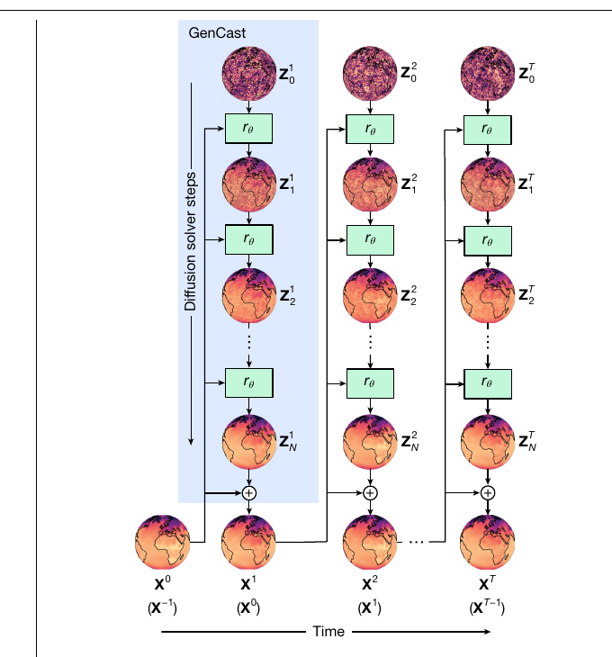

# Probabilistic Weather Forecasting with Machine Learning (GenCast)

- **Paper:** [Probabilistic weather forecasting with machine learning](https://doi.org/10.1038/s41586-024-08252-9) · [Nature article](https://www.nature.com/articles/s41586-024-08252-9)
- **Authors:** Matthew Chantry Price et al.
- **Venue:** *Nature*, 637, 84–90, 2025 (published online 4 December 2024)
- **Model resources:** [Google DeepMind GraphCast repository](https://github.com/google-deepmind/graphcast)
- **Paper type:** A global, ensemble-generating probabilistic weather model based on conditional diffusion.

> **The central idea:** A useful forecast is often a distribution of possible futures, not just one best-guess map. GenCast starts from the recent global weather state, repeatedly denoises random fields into plausible next states, and rolls those states forward. Its samples represent alternative weather trajectories and its evaluation shows strong probabilistic skill against ECMWF ENS, including a wind-power case study. The cost is a more involved, sample-based forecast and a dependence on the variables and resolution represented in the training data.

## 1. The problem: forecast uncertainty is part of the forecast

The atmosphere is chaotic and observations are incomplete. Small differences in the estimated current state can lead to different plausible weather several days later. Operational ensemble systems express this uncertainty by running multiple forecasts with perturbed initial conditions and/or model physics. A probabilistic machine-learning forecast aims to represent a similar range of outcomes while learning atmospheric evolution from data.

GenCast is designed to forecast a probability distribution over global weather states up to 15 days. It is evaluated not only by the accuracy of an average forecast but also by whether its ensemble distribution is sharp and statistically reliable. That makes its question distinct from GraphCast’s deterministic forecast comparison.

## 2. What GenCast predicts

The model uses two weather states, 12 hours apart, to predict a state 12 hours later. It then feeds generated states back into the model, repeating the process to reach 15 days. The main configuration uses a 0.25° global grid and more than 80 weather-variable fields: six surface variables and six atmospheric variables at 13 pressure levels.

Training and evaluation use ERA5 reanalysis. The reported training period spans 1979–2018; 2018 is used for validation during model development and 2019 is the principal held-out test year. The paper also describes training at a coarser resolution before fine-tuning at 0.25°. These details matter when interpreting the benchmark: the model learns from a reanalysis record and its test set is a held-out year, not an independent long-term trial across many climate regimes.

## 3. Conditional diffusion: from noise to a plausible future

For each 12-hour prediction, GenCast generates a random weather field and iteratively refines it. A diffusion denoiser estimates how to remove noise conditioned on the preceding weather states. Repeating this refinement produces one plausible next state; drawing new noise yields a different plausible future. Autoregressive rollout then extends each sample through time.

The denoiser uses an encoder–processor–decoder architecture with graph-based processing over an icosahedral mesh. Its graph transformer has 16 blocks and a 512-dimensional feature representation. Noise is defined on the sphere and represented on the latitude–longitude grid. The paper reports a 20-step sampler and 39 denoiser evaluations per prediction step. These repeated evaluations explain why generating a probabilistic ensemble involves more computation than a single deterministic pass.

*Original Figure 1 from Price et al. (2025), reproduced from the paper. Each column advances the forecast in time; within a column the denoiser progressively refines a noisy state. New random samples produce different trajectories.*

The distinction between **diffusion steps** and **forecast steps** is central. Diffusion steps refine one 12-hour forecast state. Forecast steps advance the atmospheric trajectory by 12 hours. Confusing the two makes it easy to overstate either forecast resolution or computational cost.

## 4. How the authors evaluate the probabilistic forecast

GenCast is compared with ECMWF’s ensemble forecast system (ENS), a strong operational probabilistic benchmark. The main evaluation uses continuous ranked probability score (CRPS), which rewards a forecast distribution that is both accurate and appropriately concentrated. Calibration checks ask whether events assigned a certain probability occur at a compatible frequency. The authors also examine extreme events and joint spatial/temporal behavior, because useful ensemble forecasts must represent coherent weather patterns, not just independent grid-cell distributions.

On 1,320 combinations of variables, pressure levels, and lead times, GenCast has better CRPS than ENS in 97.2% of evaluated combinations; after 36 hours the reported win fraction is 99.6%. It also performs well in calibration analyses and for several extreme-event forecasts. These are results for the paper’s particular variables, test period, score, and comparison setup; a win fraction over combinations is not a universal probability that GenCast will outperform ENS in future operational use.

The paper reports that a single 15-day forecast takes about eight minutes on one TPU v5 configuration. An ensemble can be sampled in parallel, but total resources rise with the number of samples. The reported runtime should therefore be read alongside ensemble size and hardware, rather than compared directly with the cost of one deterministic forecast.

## 5. Wind-power case study: from weather ensembles to energy risk

The study translates GenCast’s 10-m wind-speed forecasts into regional wind-power forecasts. It uses 5,344 wind farms from the Global Power Plant Database. Wind speed at each farm is interpolated from the forecast grid and converted into an idealized load factor using a generic 2-MW IEC Class II turbine power curve: cut-in at 3 m/s, rated output at 14 m/s, and cut-out at 25 m/s. The calculated farm outputs are scaled by nominal capacities and aggregated over regions with radii of 120, 240, or 480 km.

This experiment is useful because energy decisions depend on aggregate power uncertainty, not only the weather at a single grid point. The paper reports that GenCast improves CRPS by around 20% through two days and by roughly 10–20% over days two to four for these regional aggregates, with significant improvements extending to about day seven in the described setup.

It is also an idealized conversion. The experiment does not use actual turbine-level hub-height measurements or plant dispatch records. It omits site-specific power curves, wake interactions, curtailment, outages, terrain exposure, and transmission constraints. Thus, it demonstrates the potential value of probabilistic wind forecasting; it does not establish the same performance for a specific wind farm or market.

## 6. Strengths, limitations, and practical interpretation

- **Uncertainty is represented explicitly:** Different noise draws yield an ensemble of future weather states, enabling probability and risk calculations.
- **Spatially coherent samples matter:** The model generates whole weather fields rather than assigning unrelated uncertainty independently at every point.
- **The benchmark is broad but still bounded:** The main skill evaluation centers on a held-out year and on a defined set of variables and levels. Longer independent tests would strengthen claims about generalization.
- **10-m wind is not turbine hub-height wind:** The power experiment relies on 10-m winds and a generic curve. Real turbines operate higher above ground and respond to shear, stability, turbulence, wakes, and operating state.
- **Sampling has a computational price:** Iterative denoising requires repeated model evaluations. The value of a richer ensemble must be weighed against latency and hardware budget.
- **A reanalysis is not a local sensor network:** Grid-scale fields do not supply the second-scale vertical profiles available from Doppler lidar/radar or tower observations.
- **Benchmark comparisons are protocol-dependent:** Ensemble size, initialization, lead time, interpolation, verification targets, and score affect comparisons with ENS; supplementary details should be checked for a reproduction.

## 7. Connection to our research

GenCast is the clearest example in this reading set of the **probabilistic-generation route**. Its most transferable idea is to treat uncertainty as a structured forecast product. For wind energy, this opens the door to forecasts of low-output risk, ramp probabilities, and reserve needs rather than relying only on a single predicted wind speed or power value.

| Research need | GenCast connection | What our data/model would need to add |
| --- | --- | --- |
| Estimate near-term wind uncertainty | Multiple sampled trajectories and calibrated probabilistic scoring | Local verification against radar/lidar, mast, and turbine observations |
| Use vertical wind structure | GenCast provides broad atmospheric context at pressure levels | Explicit hub-height and boundary-layer representations; near-surface radar profiles and shear |
| Predict wind-power risk | The paper shows a weather-to-power aggregation workflow | Actual plant power, turbine curves, outages, wake and curtailment information |
| Fuse global and local forecasts | A global probabilistic background could supply prior context | A conditional regional model that updates the distribution with high-frequency local observations |

A promising question for our work is whether local multi-height radar can update the **distribution** of future wind profiles, rather than simply correcting its ensemble mean. That would require evaluating both point accuracy and calibration—for example, whether nominal prediction intervals achieve their stated coverage, including during rapid shear changes and ramps.

## 8. Takeaways

1. **GenCast predicts a distribution, not one future map.** Conditional diffusion turns random fields into plausible next states, and autoregressive sampling creates full trajectories.
2. **Probabilistic quality requires probabilistic metrics.** CRPS, calibration, and event reliability answer questions that deterministic RMSE cannot.
3. **The energy demonstration is promising but simplified.** Its 10-m winds and generic turbine curve establish a pathway, not a site-specific power forecast result.
4. **For our project, the core opportunity is uncertainty fusion:** combine global weather context with local, vertical, high-frequency observations and test whether uncertainty remains calibrated.

### Reading note

This summary is based on the full Nature article and its methods/results, including the wind-power experiment and stated evaluation conditions. The open full text and supplementary information are linked above for exact CRPS definitions, sampling details, and comparison protocols.
