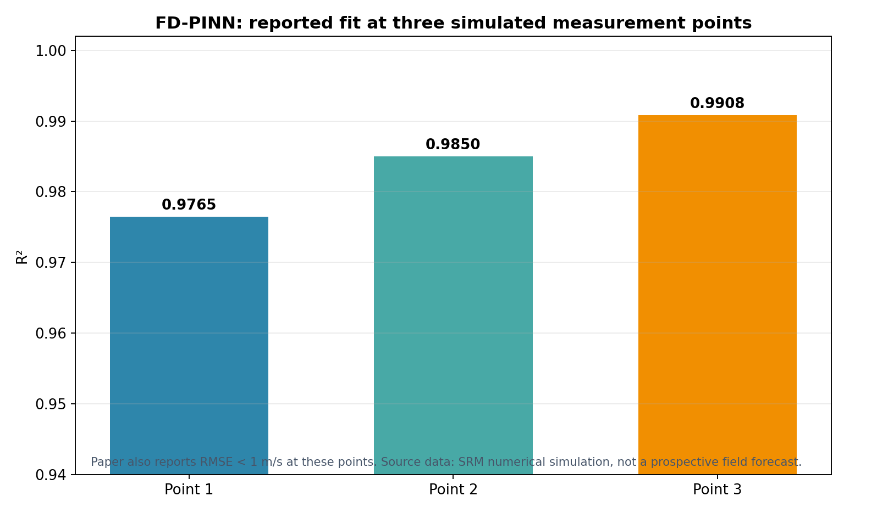

# FD-PINN：用频域信息预测风机前方三维时空风场

**原文：** Shaopeng Li, Xin Li, Yan Jiang, Qingshan Yang, Min Lin, Liuliu Peng, Jianhan Yu, “A novel frequency-domain physics-informed neural network for accurate prediction of 3D spatio-temporal wind fields in wind turbine applications,” *Applied Energy*, 386 (2025), 125526. [原文 DOI](https://doi.org/10.1016/j.apenergy.2025.125526)

## 研究问题与模型

风机前方的真实风场难以密集布点，稀疏风速观测不足以直接还原完整三维风场。作者提出 FD-PINN，把神经网络与风速谱、空间相干函数和风廓线等先验结合，在频域建模时空结构，再从少量测点恢复空间分布和时间演化。

## 数据与预测效果

主实验使用谱表示法（SRM）生成的风场模拟数据：平面上布置 121 个测点，采样频率 1 Hz、模拟时长 400 秒，并测试只提供部分空间测点时的风场恢复效果。论文比较了 70%、50%、30% 和 10% 等不同测点比例，并与常规神经网络方法比较。

*根据论文报告的三个测点 R²（0.9765、0.9850、0.9908）重绘；作者报告对应 RMSE 均小于 1 m/s。图中数值来自论文，不是我们的独立复算。*

论文还展示平均风廓线、湍流强度、风速谱和相干函数的预测/真实对照，报告模型能捕捉垂直风切变及频域特征；测点比例减少时精度会下降，但物理先验帮助稀疏观测下恢复风场。

## 实验自洽性：预测结果的证据边界

它确实展示了预测曲线、误差统计和基线对照，但主实验的“真实值”是 SRM 合成风场，不是现场雷达或测风塔连续采集的独立风场。因此，结果能说明模型在设定的谱模型、边界条件和采样结构下恢复/预测能力较好；不能直接据此宣称模型已在真实大气环境中达到同等误差。

文章讨论真实观测数据的比较，但其主要量化实验依赖仿真场。复现实验时应把数值模拟与现场测量两栏分开，并要求现场数据留出独立时段或天气过程，而不是把仿真训练/测试拆分作为现场验证的替代。

## 对我们的连接

- 和秒级、多高度雷达的关联很强：模型关注稀疏测点、频域结构和三维风场，能提供稀疏观测插值/短时预测的思路。
- 可以复用其思路做“测点子采样”实验：从 L300 的距离门/高度层随机或按布点方案删减数据，分析重建误差随有效测点数怎样变化。
- 但评价必须用同一现场事件中独立保留的测点或同步塔架/声学风速计，不能用被输入模型的雷达点再次充当验证真值。

## 组会可讨论

这篇的 R² 接近 1，主要说明模型对 SRM 生成风场的拟合能力。我们需要什么样的跨天气、跨高度、独立仪器对照，才能验证它对真实切变预测也成立？
