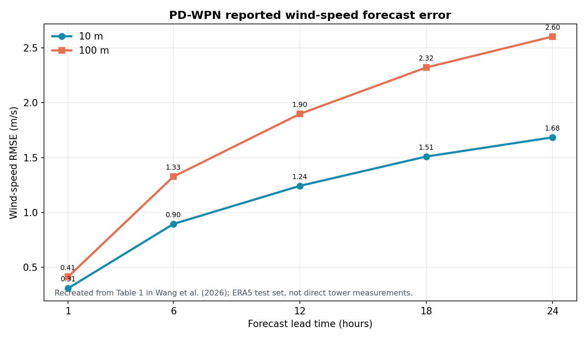

# PD-WPN：加入物理引导与不确定性演化的多高度风速预测

**原文：** Junkai Wang, Yu Zhang, Yiming Ren, Qiong Li, Lianlei Lin, Hangyi Yu, Hanqing Zhao, Zongwei Zhang, Sheng Gao, Yupu Yang, “Physics-guided neural network integrating uncertainty evolution for spatiotemporal wind speed prediction,” *Communications Earth & Environment* (2026). [DOI / 开放原文](https://doi.org/10.1038/s43247-026-03844-x)

## 方法主线

PD-WPN 预测多高度三维风速场，组合三类设计：跨时间/高度/空间轴的注意力、以潜在状态演化表达物理动态的 PIU 单元，以及对不同预测约束自适应加权的不确定性损失。模型输出未来风速、风向和空间场结构，预测时效最长 24 小时。

## 数据和测试设置

主要输入是 ERA5 再分析场：10 m 与 100 m 的 U/V 风分量为逐小时、0.25° 网格；中间高度通过模式层高度重建和垂直插值取得。实验覆盖中国西北、华北、华东和东北区域。主区域按时间切分：2018–2021 年训练、2021–2022 年验证、2022–2023 年测试；测试时间不进入训练和验证。作者也与 ECMWF-HRES 比较。

*依据论文消融表中的 PD-WPN 数值重绘：10 m 的 RMSE 从 1 小时 0.309 m/s 增至 24 小时 1.684 m/s；100 m 从 0.414 m/s 增至 2.602 m/s。*

## 主要预测结果

- 相较深度学习基线，完整 PD-WPN 在多个高度和预测时效有更低 RMSE；移除跨轴注意力、物理信息单元或不确定性损失后，误差整体上升。
- 12 小时预测时，10 m RMSE 为 **1.24 m/s**，100 m 为 **1.90 m/s**。24 小时的误差继续增加，说明短期表现不能直接外推到长时效。
- 与 ECMWF-HRES 的比较显示，PD-WPN 在约 5 小时内风速误差更低；更长时效下 HRES 逐步占优。论文明确说明该基准比较使用 ERA5，而非直接现场观测。

## 实验自洽性：能否替代物理现场实验

该研究有严格的按时间留出测试和跨区域分析，能支持“在 ERA5 场上泛化到未来时间段/不同区域”的结论。但作者也明确指出 ERA5 是再分析资料，不是直接观测。因此，这些指标不能作为雷达/lidar 与测风塔精度的证据，也不能替代真实设备的同步外场验证。

若要迁移到秒级或分钟级雷达数据，需重新检验时间分辨率、空间尺度、高度插值和仪器误差；ERA5 的逐小时、0.25° 网格与局地边界层观测尺度不同。

## 对我们的连接

- 物理约束与不确定性建模适合迁移到多高度风场，但应把“对再分析场的预测误差”和“相对于现场仪器的误差”分开报告。
- 训练/测试按时间分离的思路值得沿用；另做按天气过程留出的事件测试，可以防止相邻滑窗造成结果过于乐观。
- 若目标是风切变，可在风速场预测之外直接评估垂直梯度、切变事件分类和告警提前量，并将测量不确定度传播进预测置信区间。

## 组会可讨论

再分析场测试精度高，是否意味着局地雷达风场预测也可靠？需要哪些同址观测、时间尺度和独立测试事件，才能回答这个问题？
