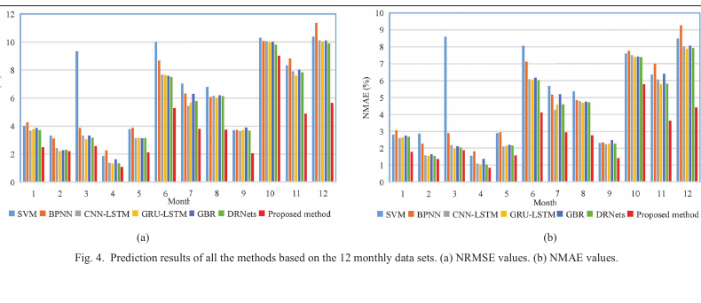

# 基于风场 SCADA 数据的短期风功率预测：小波去噪与多特征 LSTM

**原文：** Z.-H. Liu et al., “A wavelet-LSTM model for short-term wind power forecasting using wind farm SCADA data,” *Expert Systems with Applications*, 247, 123237 (2024). [DOI / 原文](https://doi.org/10.1016/j.eswa.2024.123237) · [作者接受稿（CC BY 4.0）](https://eprints.whiterose.ac.uk/id/eprint/225272/)

## 这篇论文在解决什么问题

风机 SCADA 同时记录风速、风向、桨距、转速、发电机状态和功率等信号。作者希望从这些相关但噪声较多的时序变量中提取短期功率变化信息，避免只依赖单一风速输入。

## 方法与数据

研究使用中国南方一个风场的真实 SCADA 记录，采样间隔 15 分钟，选取 54 个机组运行和环境参数，以有功功率为预测目标。方法分三步：

1. 对功率以外的 SCADA 特征做小波变换，重构低频成分作为去噪特征。
2. 用最大信息系数（MIC）筛选与功率关系较强的变量，并按月重新筛选。
3. 用多特征 LSTM 建模过去 24 小时的记录，预测下一时刻或未来 15、30、45、60 分钟的功率。

单步任务按月份拆成 12 个评估任务，每月最后两天作测试；多步任务按季度分成四段，每段最后七天作测试。对照模型包括 SVM、BP、CNN-LSTM、GRU-LSTM、GBR 和 DRNets。

*原文 Figure 4，展示 12 个月各模型的归一化误差；图像取自作者接受稿，CC BY 4.0，Liu et al. (2024)。*

## 主要结果

- 单步预测中，作者方法的月平均 NRMSE 为 **3.7391%**，NMAE 为 **2.7055%**，低于所比较的基线模型。
- 多步预测中，四个季度、15–60 分钟预测时距的平均 NRMSE 为 **7.3452%**，NMAE 为 **5.1096%**；预测时距越长，误差总体越大。
- 结果支持“去噪 + 特征筛选 + 时序模型”对该风场这批 SCADA 数据有帮助，但指标是同一风场历史数据留出测试的误差。

## 实验自洽性：这项结果能说明什么

这是基于真实风机 SCADA 的**回顾性数据实验**：信号来自真实机组，测试集与训练集按时间分开，因此比随机打散时间点更贴近未来预测。但它仍不是模型冻结后在现场连续运行、由独立仪器同步验收的前瞻性试验，也不证明换风场、换风机或接入雷达后仍有同样效果。

文中多步测试用每个季度最后七天，适合短期时间外推；但要迁移到新风场，还应做跨风场或跨机组测试。另一个复核点是预处理和 MIC 特征筛选是否只在训练段拟合；实际复现时要确保测试段信息没有进入去噪阈值、归一化参数或特征筛选。

## 对我们研究的连接

- 可作为“真实运行数据 + 时间顺序留出测试”的风功率预测基线。
- 如果加入 L300 毫米波雷达或 lidar，建议做同一时间段上的消融：SCADA-only、SCADA + 雷达、SCADA + lidar，并使用同一时间外推测试段。
- 雷达风速不是功率标签的替代物。功率标签仍来自经过状态筛选的 SCADA/电表；雷达或 lidar 的作用是补充轮毂高度外部风场信息。
- 需要把限电、停机、故障、偏航和功率曲线运行区间分开处理，否则模型可能把控制行为误学成风速—功率规律。

## 组会可讨论

1. 先预测 15 分钟功率，还是先预测风速再通过功率曲线换算？两种误差如何传播？
2. 如果有高频雷达数据而 SCADA 是 10–15 分钟采样，怎样聚合/对齐才能保证比较公平？
3. 论文中的时间留出测试和“冻结模型后的现场影子运行”分别能回答什么问题？
