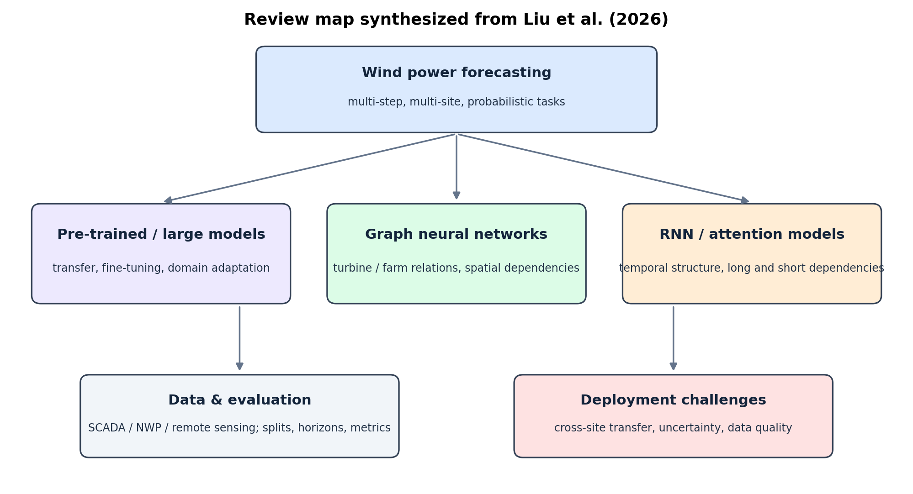

# 风功率预测深度表征综述：从 RNN/GNN 到预训练大模型

**原文：** Decheng Liu, Yunfei Yan, Shuai Chen, Bo Wang, Xinghua Li, Haibin Zhang, “Wind power forecasting with deep representation: A survey,” *Applied Energy*, 421 (2026), 128106. [原文 DOI](https://doi.org/10.1016/j.apenergy.2026.128106)

## 这篇综述讲什么

本文梳理风功率预测（WPF）中的深度表征方法，重点比较预训练大模型/LLM、图神经网络（GNN）和循环神经网络（RNN），并讨论注意力机制、缺失值和异常值处理、信号分解、公开数据集、预测时效与应用场景。它的价值是把“用了什么网络”与“数据如何准备、实验怎样比较”放在同一张地图上。

*本图为依据 Liu et al. (2026) 综述内容重新整理的示意图，不是论文原图。*

## 主要观点

- RNN 类方法擅长时间依赖；GNN 可表达风机、风场或空间节点之间的关系；预训练模型尝试从多任务/大规模时序数据中获得可迁移表示。
- 注意力可以作用于时间、特征和空间等维度；分解、滤波、缺失值处理会改变输入和评估结果，不能被当作无关紧要的“数据清洗”。
- 风功率论文使用的数据集、预测时效、训练/测试划分、功率归一化口径和指标并不一致，因此单看某篇论文的最高 R² 或最低 RMSE，通常不能据此判定模型总体更好。
- 跨风场迁移、不同机组和场景适配、不确定性估计、数据共享与联邦学习仍是重要问题。预训练大模型方向值得关注，但要靠可复现基准验证，而不是只凭模型规模推断效果。

## 阅读后的判断

这篇适合用来建立方法地图和挑选对照路线，不适合直接当作某个新模型“已经有物理现场效果”的证据。组会里建议把不同论文的结果先按数据来源分成：真实 SCADA 回顾性测试、遥感/再分析产品测试、数值模拟测试、前瞻性现场运行，再比较同一类别中的模型指标。

## 对我们的连接

对加入 L300 mmWave / lidar 的风功率预测，至少要对照 SCADA-only、SCADA + 雷达、SCADA + lidar 三组输入；同一时间切分、同一功率目标、同一预测时效和同一评价指标。只有在时钟、风机状态和观测高度都对齐后，新增传感器带来的指标改进才可归因于额外风场信息。

## 组会可讨论

1. GNN 是否适合表达不同高度测点、不同风机或相邻雷达距离门之间的关系？
2. 新增高频雷达变量后，怎样做时间聚合和防止未来信息泄漏？
3. 论文间指标不可直接横比时，我们要怎样设计统一 benchmark？
