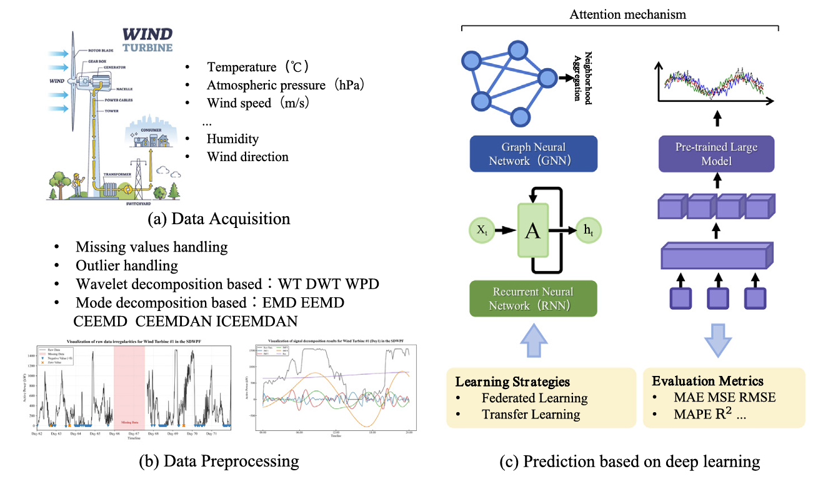
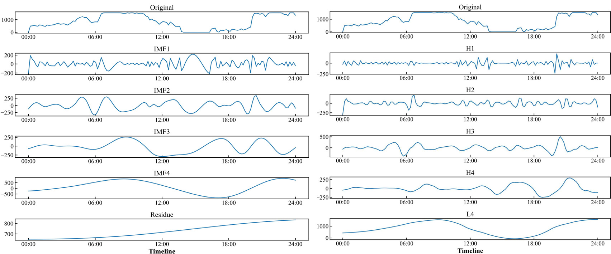
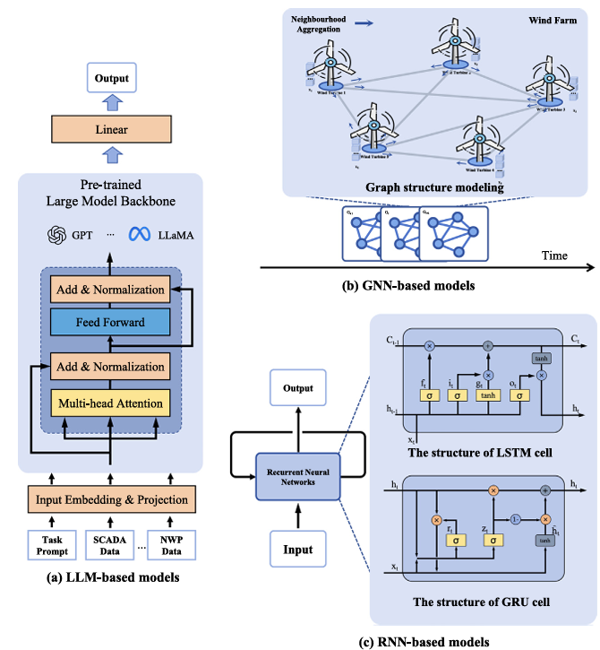
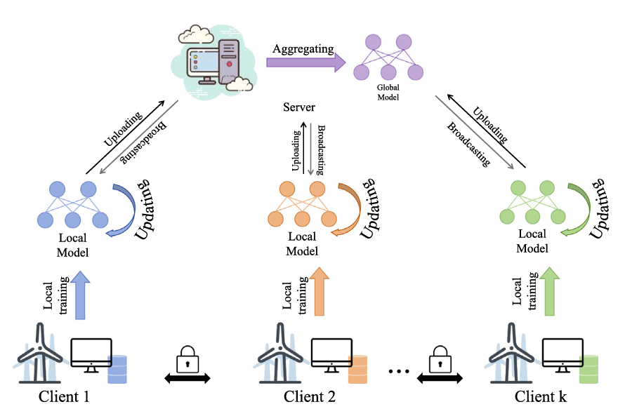

# Wind Power Forecasting with Deep Representation: A Survey

- **Paper:** [Wind power forecasting with deep representation: A survey](https://doi.org/10.1016/j.apenergy.2026.128106)
- **Authors:** Decheng Liu, Yunfei Yan, Shuai Chen, Bo Wang, Xinghua Li, and Haibin Zhang
- **Published in:** *Applied Energy*, 421 (2026), article 128106
- **Article type:** Survey of deep-representation methods for wind power forecasting (WPF), not a new model proposal
- **Reading basis:** Full 23-page article, including its figures and comparison tables

> **Main message:** Recent WPF research is moving from single power-series models toward multi-source, multi-scale and spatiotemporal representations. The review organizes the field around data preparation, model families (LLM/large time-series models, GNNs and RNNs), attention, transfer and federated learning, benchmark settings, and real operational value. Its central practical lesson is that no architecture is best in every scenario: choose the model and evaluation around the site, horizon, data and downstream decision.

## 1. Why wind-power forecasting needs more than a time-series model

Wind power is intermittent because it depends on changing weather, turbine operation and interactions among turbines. The paper describes a progression from physical, statistical and classical machine-learning methods to deep learning that can learn nonlinear temporal and spatial patterns from data.

WPF inputs often combine environmental variables—wind speed, direction, temperature, pressure and NWP forecasts—with turbine status such as generator speed, pitch angle and component temperatures. SCADA systems commonly record these at 10- or 15-minute intervals. A useful model must therefore deal with data quality and alignment before learning relationships.

The authors review literature primarily from 2020–2025 and organize the review into four linked pieces: preprocessing; model representations and attention; learning strategies; and experimental/application analysis. Their publication-trend analysis reports sustained growth in WPF studies, with RNNs remaining common, GNNs increasing, attention increasingly used, and LLM-based approaches only beginning to emerge.

*Liu et al., Fig. 4, p. 3. [Original article](https://doi.org/10.1016/j.apenergy.2026.128106).*

The framework links data acquisition and preprocessing to prediction, learning strategy, and evaluation. It makes clear that forecasting quality depends on the full pipeline, not only the choice of network.

## 2. Data preparation changes what the model can learn

The article treats preprocessing as part of the forecasting method, not a neutral preliminary step.

| Data issue | Methods reviewed | Important caveat |
|---|---|---|
| Missing SCADA values | Previous-value fill, interpolation (including B-splines), KNN, regression, autoencoder-based imputation | Imputation may smooth genuine fast changes; it must use only information available at forecast time |
| Abnormal values / outliers | Statistical rules, robust regression, DBSCAN, isolation forest, robust loss functions | A rare but real ramp or extreme condition can be incorrectly removed as an “outlier” |
| Redundant inputs and different scales | PCC, PCA, manifold learning, ReliefF, mutual information/MIC, normalization | Feature relevance can be nonlinear or spatial; a single correlation score may miss useful relationships |
| Nonstationary, multi-scale signals | Wavelet and mode-decomposition methods | Decomposition adds choices and compute; the method, level and parameters affect the learned signal |

### What signal decomposition is doing

The intuition behind Fig. 6 is to split a complicated power series into components at different time scales. A model can then learn the smoother trend and faster fluctuations separately or as a set of components.

*Liu et al., Fig. 6, p. 6. [Original article](https://doi.org/10.1016/j.apenergy.2026.128106).*

The two panels show the same power series represented as EMD intrinsic mode functions and wavelet components. Their different component shapes and residual trends show why decomposition choices affect what a forecasting model can learn. For the related family overview, see [Fig. 5, p. 6](https://www.sciencedirect.com/science/article/pii/S0306261926007580#fig5).

- **Wavelet transform (WT/DWT):** provides localized time-frequency information. The review notes that ordinary DWT mainly continues decomposing the low-frequency branch; **wavelet packet decomposition (WPD)** also decomposes high-frequency branches, which may preserve additional detail. Results depend on the mother wavelet and decomposition level.
- **EMD:** adaptively decomposes a signal into intrinsic mode functions (IMFs) without selecting a fixed basis in advance. Its known issue is mode mixing.
- **EEMD / CEEMD / CEEMDAN / ICEEMDAN:** add noise and ensemble averaging in different ways to reduce mode mixing. Trade-offs include runtime, residual noise, inconsistent mode counts, and sensitivity to noise/algorithm parameters.
- **VMD:** solves a constrained variational decomposition problem and estimates band-limited modes with center frequencies. It has a more explicit mathematical formulation and can reduce mode mixing, but depends on the chosen number of modes, K.
- **Multi-VMD:** decomposes multiple channels jointly so their frequency components can be aligned, rather than decomposing only the power series.

The review’s message is not “always decompose first.” It is that decomposition can simplify learning for nonstationary signals, but its added complexity and possible information loss must be justified by validation on the target dataset.

## 3. Four roles for attention

The paper groups attention by the dimension it helps model:

| Attention dimension | Question it helps answer | Examples of use reviewed |
|---|---|---|
| Temporal | Which historical time steps matter for the forecast? | Weighting recent or long-range history; adapting the input horizon |
| Feature | Which variables matter now? | Weighting NWP variables, weather measurements and turbine status |
| Spatial | Which turbines or sites influence one another? | Attention over graph neighbors, turbine arrays or wind-farm clusters |
| Other roles | How do we handle time lag, uncertainty or heterogeneous inputs? | Correcting NWP observation lag, Bayesian uncertainty modeling, cross-modal fusion and transfer under distribution shift |

Attention weights can show what the model emphasized, but they are not automatically a causal or physically faithful explanation. The paper presents interpretability as a potential role, while also identifying trustworthy interpretation as an open challenge.

## 4. Three model families—and their trade-offs

*Liu et al., Fig. 7, p. 8. [Original article](https://doi.org/10.1016/j.apenergy.2026.128106).*

The sketches place the three model families side by side: recurrent models process a sequence, graph models represent relations among turbines, and pre-trained large models operate on encoded time-series representations. The sections below explain when each representation is useful and what can go wrong.

### Recurrent neural networks: strong temporal baselines

LSTM, GRU and their bidirectional or hybrid variants learn sequential dependencies in SCADA and NWP histories. They remain competitive for ultra-short-term through medium-term prediction, especially for a single turbine or wind farm.

- **Strength:** natural fit for time-ordered power and weather sequences.
- **Limit:** sequential computation can be less efficient, and a plain RNN does not explicitly represent relations among turbines or sites.
- **Model choice:** GRU uses fewer gates than LSTM and can be more computationally efficient; hybrid CNN/RNN models separate local feature extraction from temporal learning.

### Graph neural networks: explicit spatial relationships

GNNs represent turbines or farms as nodes and their relationships as edges. GCNs aggregate information from graph neighbors; GATs learn different weights for neighbors; adaptive graph and spatiotemporal GNNs can learn or update relationships while modeling changes over time.

- **Strength:** suitable when turbine layout, wake direction, regional dependence or cross-farm correlation matters.
- **Limit:** performance depends on how the graph is built. A geographic-neighbor graph may not capture changing wind direction or functional relations. Large graphs can also add computational cost.
- **Design question:** should edges represent physical distance, prevailing wind/wake direction, statistical dependence, or a learned relationship? The paper discusses multiple graph construction and fusion approaches rather than establishing one universally correct graph.

### Pre-trained large models and LLMs: promising, still early

The review includes BERT-style spatiotemporal models, models that encode continuous wind variables, prompt-based use of pretrained language/time-series models, cross-modal conversion, and parameter-efficient fine-tuning such as LoRA. Some studies use NWP, SCADA, text or prior information together.

- **Potential:** reuse of pretrained representations, few-shot or zero-shot adaptation, and support for longer or multi-source tasks.
- **Current difficulty:** numerical time series are not text. The data-to-token or modality alignment, prompt design, adaptation strategy, compute and interpretability all matter.
- **How mature?** The paper says LLM methods are an emerging direction. Their appearance in the literature should not be read as proof that LLMs consistently outperform simpler models in operational WPF.

### A compact comparison

| Family | Best-matched structure | Typical setting | Main risk |
|---|---|---|---|
| RNN/LSTM/GRU | Temporal dependence | Single turbine/site; short to medium horizons | Weak explicit spatial modeling; sequential cost |
| GNN/STGNN | Relationships among turbines/sites over time | Multi-turbine farm or farm cluster | Graph quality, scale and dynamic relations |
| LLM / pretrained time-series model | Reusable representation and heterogeneous inputs | Data-scarce, multi-source or cross-scenario experiments | Modality mismatch, prompt/adaptation complexity, limited interpretability |

The authors explicitly caution that model superiority is scenario-dependent. Table 3 is best read as a map of fit and limitations, not as a single ranking.

## 5. Transfer learning and federated learning solve different problems

- **Transfer learning** reuses knowledge from a source farm or period to help a target farm or future regime with limited data. It can address cold-start and distribution shift, but a source-target mismatch can cause **negative transfer**. Adaptive layer freezing, adversarial domain training and dynamic feature transfer are among the approaches reviewed.
- **Federated learning** lets several farms train collaboratively while keeping raw records local and exchanging parameters, gradients or intermediate representations. It addresses data islands and privacy restrictions, but faces client heterogeneity, aggregation bias, communication cost and unequal local data.
- **Together:** the paper treats them as complementary: federation shares learning across sites; transfer/personalization adapts the shared model to each site. Personalized robust aggregation and federated split learning are examples of attempts to address heterogeneous data or limited edge compute.

*Liu et al., Fig. 8, p. 14. [Original article](https://doi.org/10.1016/j.apenergy.2026.128106).*

Each farm trains locally and shares model updates for aggregation, illustrating how sites can collaborate without pooling raw SCADA records.

Neither method automatically guarantees privacy or generalization; the system’s threat model, exchanged information and cross-site validation still need to be checked.

## 6. Datasets and experiment design

The survey highlights several public datasets:

- **SDWPF:** 134 turbines, 10-minute data over 245 days, 13 feature dimensions and turbine locations. It includes environmental and turbine-state information and was used in the Baidu KDD Cup.
- **GEFCom2012:** data and NWP from seven wind farms at hourly resolution over nearly three years.
- **GEFCom2014:** data and NWP from ten Australian wind farms at hourly resolution from 2012 to 2014.
- **WIND Toolkit:** high-resolution meteorological wind-resource data across the contiguous United States for 2007–2013.
- **Turkey SCADA dataset:** 10-minute turbine-operation records including power, hub-height wind speed/direction and theoretical power.

The datasets differ in geography, sampling, number of farms, sensor variables and forecast target. The review’s Table 4 also compiles model-specific train/validation/test splits, epochs, horizons and reported metrics. Those scores should **not** be compared as if they came from one controlled leaderboard: many studies use private data, different power scales and different splits.

For deterministic prediction, the article discusses MAE, MSE, RMSE, MAPE and R², plus normalized metrics. It notes that absolute errors are hard to compare across devices of different rated capacity. Although uncertainty-aware methods appear in its model discussion, the article says probabilistic metrics such as coverage and interval width are outside its main experimental focus. This is a meaningful boundary of the review.

The authors describe common forecast horizons as ultra-short-term (seconds to 30 minutes), short-term (30 minutes to 6 hours), medium-term (6 hours to 1 day) and long-term (beyond 1 day), while noting there is no universally accepted definition. Historical input length also matters: too short misses useful context; too long increases compute and may add noise or overfit. It should be selected on validation data and documented with the prediction horizon.

## 7. Application value: forecast errors are not the whole objective

The paper separates inland and offshore challenges:

- **Inland:** complex terrain, vegetation, buildings and local atmospheric effects create spatial heterogeneity and irregular wind changes.
- **Offshore:** stronger marine variability, wake interactions, regime shifts, sparse or interrupted observations, maintenance constraints and severe weather create robustness challenges.

It then maps model requirements to power-system uses (Table 5): day-ahead bidding needs stable multi-step forecasts; real-time markets need frequent ultra-short-term updates; microgrids need risk-aware support for storage and reliability; grid dispatch and reserve scheduling benefit from spatial modeling and uncertainty information.

A key conclusion is that **lower MAE or RMSE does not necessarily mean greater operational value**. Under-forecasting and over-forecasting can have different costs. The paper recommends evaluating whether a forecast helps dispatch, reserve allocation, market bidding, secure supply or renewable integration—not just whether it fits historical values.

## 8. Main research gaps and future directions

The authors identify four connected challenges:

1. **Data availability and reproducibility:** missing/noisy SCADA, inconsistent time and space resolutions, private datasets, few common benchmarks and incomplete code/preprocessing releases.
2. **Physics-informed deep representations:** many reviewed models are data-driven and do not sufficiently encode turbine power curves, operating characteristics, wake effects or meteorological consistency. The authors point to physics-informed learning as a way to improve robustness and cross-scenario generalization.
3. **Interpretability and trust:** operators need to understand which variables, times, sites and uncertainties drive a forecast.
4. **Value-oriented evaluation:** connect prediction objectives to operating costs, asymmetric risks and downstream decisions.

They also mention time-series foundation models, physics-informed neural networks and quantum-computing-based forecasting as emerging possibilities. The paper cautions that these directions are early and still require evidence of effectiveness, scalability and deployment readiness.

## 9. What this means for our radar + AI work

This review focuses on wind-power prediction from SCADA, weather/NWP inputs and turbine/farm relations. It does **not** demonstrate second-level, multi-height Doppler-radar assimilation or validate 20–300 m wind profiles at 20 m spacing. That gap is useful to state precisely.

A research path suggested by the review is to test the added value of each source separately and together:

1. Use NWP as the large-scale background and SCADA as the turbine-operation/power record.
2. Represent radar measurements as height-resolved, high-frequency local observations; align them carefully with slower SCADA and NWP inputs.
3. Compare a temporal baseline with a spatial/graph model when farm or turbine interactions matter.
4. Test whether the radar improves hub-height wind, vertical shear, ramp detection and power forecasts across forecast horizons and weather regimes.
5. Report standard errors, rated-capacity-normalized errors, uncertainty calibration, and decision-relevant costs where possible.
6. Test on independent time periods or sites to detect leakage and negative transfer.

This is a proposed experiment motivated by the review, not a result reported by its authors. The cadence mismatch itself is central: the review describes SCADA records commonly sampled every 10–15 minutes, while our radar provides second-level observations. Resampling or fusion must preserve the fast variability we hope to add.

### Takeaways for the group

- Start with the data pipeline and forecast scenario before choosing an architecture.
- Use RNNs for a strong temporal baseline; consider GNNs when spatial relations among turbines or farms matter; treat LLM/large pretrained methods as promising but still developing.
- Decomposition can help with multi-scale signals, but requires careful parameter selection and leakage-safe validation.
- Transfer and federation address different constraints and can be combined, with negative transfer and heterogeneity checked explicitly.
- Evaluate both statistical accuracy and usefulness for trading, dispatch, reserves or safety decisions.

### One-sentence summary

**This review’s most useful contribution is its end-to-end map of WPF—from SCADA cleaning and signal decomposition through temporal/spatial representations to application-aware evaluation—and its reminder that real value depends on matching the method to the site and decision.**
