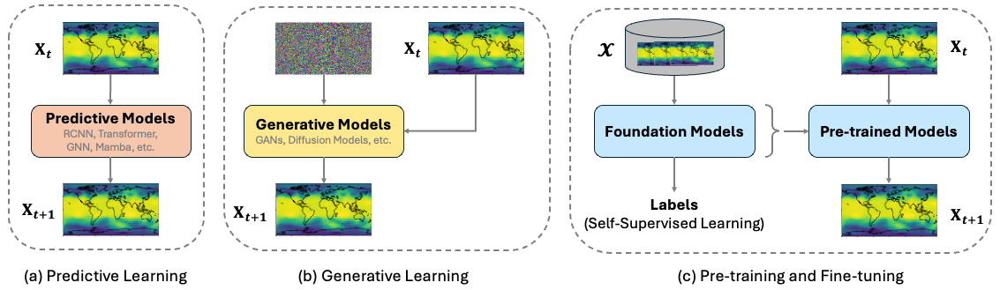
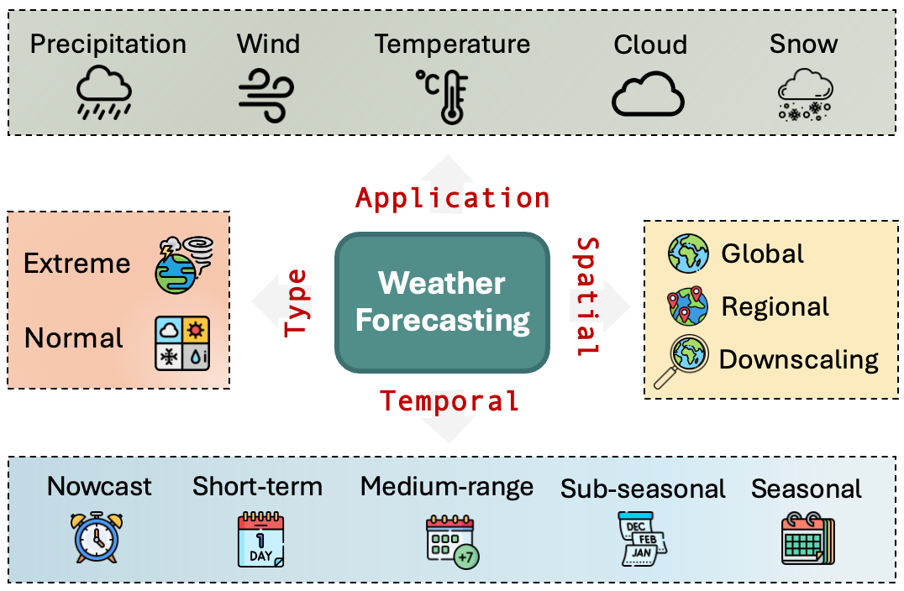

# Deep Learning and Foundation Models for Weather Prediction: A Survey

- **Paper:** [Deep Learning and Foundation Models for Weather Prediction: A Survey](https://doi.org/10.24963/ijcai.2026/890)
- **Authors:** Jimeng Shi et al.
- **Published in:** *Proceedings of the Thirty-Fifth International Joint Conference on Artificial Intelligence (IJCAI 2026)*, Survey Track, pp. 8023–8031
- **Resources:** [Official IJCAI paper page and PDF](https://www.ijcai.org/proceedings/2026/890) · [authors’ paper, code, and dataset index](https://github.com/JimengShi/DL-Foundation-Models-Weather)
- **Article type:** Survey and taxonomy, not a new forecasting model
- **Reading basis:** Full 9-page paper

> **The main point:** The authors classify weather AI by how it is trained: deterministic prediction, probabilistic generation, and pre-training followed by fine-tuning. This is a useful way to choose methods because the three paradigms answer different needs: one best-guess forecast, a distribution of plausible forecasts, or a reusable representation for adapting to new tasks.

## Why organize the field by training paradigm?

Weather fields have strong spatial and temporal structure, but the output a user needs varies. A power operator may need a single expected wind field, an ensemble of plausible futures, or a model that can be adapted to a new region with limited labels. The paper argues that the learning objective and output should be considered alongside architecture names.

*Shi et al., Fig. 2, arXiv:2501.06907v1 (2025). [Full preprint](https://arxiv.org/abs/2501.06907).*

This figure illustrates why the training objective matters: deterministic learning gives a single forecast, generative learning samples plausible futures, and pre-training creates a representation that can be adapted.

### The three paradigms

| Paradigm | What the model returns | Representative approaches in the survey | Main trade-off |
|---|---|---|---|
| Deterministic predictive learning | One future state or sequence | Pangu-Weather, GraphCast, FourCastNet; Transformer, graph, recurrent, convolutional and state-space backbones | Efficient forecasts, but pointwise objectives can smooth uncertain or fine-scale outcomes |
| Probabilistic generative learning | Multiple plausible future states, used to represent a forecast distribution | GenCast, CasCast and other diffusion or GAN-based systems | Represents uncertainty and alternative futures, but sampling can increase inference cost and requires calibration checks |
| Pre-training and fine-tuning | A reusable representation adapted to a downstream task | Aurora, Prithvi WxC, ClimaX, W-MAE and related weather foundation models | Promises transfer across variables or tasks, but depends on pre-training data, adaptation and evaluation |

These categories are about *how a model learns and what it outputs*. They are not the same as architecture categories. For example, a Transformer can be used for point prediction or pre-training; diffusion is a generative approach; and a graph network describes how spatial relationships are represented.

## The task dimensions matter before the model name

The authors describe weather prediction along four task dimensions:

- **Lead time:** minutes and hours (nowcasting), days (medium range), or longer horizons.
- **Spatial scope:** global or regional/domain-specific.
- **Target:** variables such as temperature, humidity, wind, or precipitation.
- **Event type:** ordinary conditions or events such as heavy rainfall, heatwaves, storms, and cyclones.

*Shi et al., Fig. 1, arXiv:2501.06907v1 (2025). [Full preprint](https://arxiv.org/abs/2501.06907).*

The figure organizes tasks by lead time, geographic scope, target variable, and event type. These dimensions explain why a global medium-range model should not automatically be treated as a local, second-level wind-profile predictor.

A method designed for global medium-range fields at coarse time intervals should not be assumed to solve local radar nowcasting or second-level wind-profile prediction. The input cadence, resolution, target, and evaluation metric all change.

## What model architectures are covered?

The survey reviews several backbones and explains the relationships they encode:

- **Transformers and vision Transformers** turn gridded weather maps into tokens or patches and use attention to model spatial and temporal dependencies.
- **Graph neural networks** represent locations or grid cells as nodes connected by a graph, which can support global spherical meshes or other non-rectangular relationships.
- **RNNs and CNNs** are common in domain-specific and nowcasting settings, where local space-time evolution is central.
- **Mamba/state-space models** are included as newer options for handling long sequences with different computational scaling.
- **GANs and diffusion models** are used for probabilistic generation.
- **PhysicsAI and hybrid approaches** combine learned components with physical equations or model structure.

The useful question is not “which backbone is best?” but “what relationship does this representation encode, and is that relationship appropriate for this forecast task?”

For the paper’s cross-category map, see [original Figure 3 in the official IJCAI 2026 PDF, p. 3](https://www.ijcai.org/proceedings/2026/0890.pdf#page=3).

## How to interpret the paper’s comparisons

The paper compiles representative global models and compares information such as training data, spatial resolution, hardware or inference cost, and forecast errors for selected variables and lead times. Its discussion supports several qualified observations:

1. **Learned global forecasts can be much faster to produce than a full operational NWP run.** The paper cites seconds-to-minutes inference for systems such as Pangu-Weather or GraphCast on modern accelerators and contrasts this with a much longer IFS HRES run in the cited setup. This is a comparison of reported implementations and hardware, not a universal speed ratio.
2. **Point forecasts and probability forecasts answer different questions.** A low RMSE for a single predicted field does not tell a user the chance of a high-impact alternative. Generative forecasts add distributional information, with extra computational and calibration considerations.
3. **Resolution is not the only determinant of skill.** The survey notes cases where models at different grid resolutions remain competitive on selected variables. Results depend on architecture, training data, target, and metric.
4. **Table values are not a perfectly controlled tournament.** Models may differ in data, resolution, lead time, training resources, and evaluation protocol. Read each comparison with its setup.

The survey summarizes results from prior work; these numbers are not a new experiment run by the survey authors.

## What the authors identify as next steps

The paper closes with six directions:

1. **Weather-data storage and management:** compression and efficient representations for very large datasets.
2. **Knowledge distillation:** smaller models that retain useful capabilities of large teachers.
3. **Probabilistic forecasting:** stronger treatment of forecast uncertainty and evaluation of generated ensembles.
4. **Weather prediction and understanding:** models that go beyond producing fields toward interpreting weather information.
5. **Agentic weather systems:** coordinating data, models, and tools across multi-step tasks.
6. **Operational deployment:** reliable uncertainty, explainability, provenance, human oversight, and practical robustness.

The deployment point is particularly important: a model that performs well on a benchmark still needs an auditable data and model pipeline before it can support a high-stakes decision.

## Connection to our research

The paper gives us a vocabulary for positioning our problem:

- A global weather model can provide **large-scale context**.
- Local radar or lidar can supply **high-frequency, multi-height observations** that may reveal site-level wind structure and shear.
- A deterministic model could predict a best-estimate wind profile or power trajectory.
- A probabilistic model could represent uncertainty in ramps, shear, or local conditions.
- Fine-tuning or other adaptation could test whether a general weather representation transfers to our region and sensor variables.

The survey does not evaluate this exact combination. We would need to test sensor alignment, missing data, vertical-coordinate mapping, lead-time dependence, and calibration on independent sites or periods. In particular, global benchmark skill does not establish skill at second-level cadence or at turbine hub height.

### Questions for a reading group

1. For our application, is the decision improved most by a better point forecast, a calibrated range, or both?
2. Which local variables from the radar are genuinely new information beyond the global background?
3. What would count as transfer: a frozen representation, fine-tuning, or retraining a site-specific model?
4. Which splits and metrics would prevent temporal or site leakage?

### One-sentence summary

**Use this paper’s “training paradigm × architecture × spatial scope” map to decide what kind of weather model fits the task before comparing model names or headline scores.**
