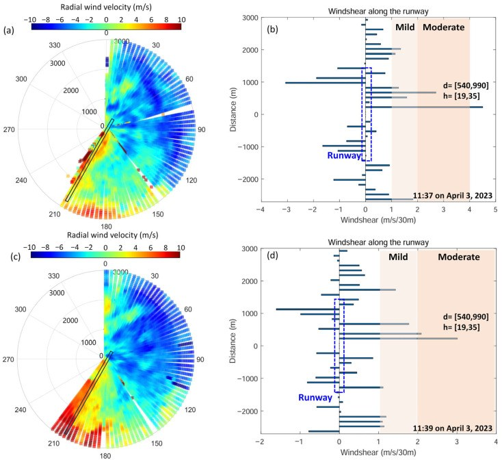

# 相干多普勒激光雷达的低空风切变识别：仿真算法与机场实测

**原文：** Y. Wei, J. Yuan, C. Chen, T. Wu, and Z. Tong, “Typical Wind Shear Simulation and Detection Analysis Based on Coherent Doppler Wind Lidar,” *Sensors*, 26(5), 1643 (2026). [DOI / 开放原文](https://doi.org/10.3390/s26051643) · [PMC 全文](https://pmc.ncbi.nlm.nih.gov/articles/PMC12986640/)

## 研究问题

低空风切变尺度小、持续时间短，单点地面风速计难以描述跑道附近的空间结构。论文关注相干多普勒风 lidar 的风场扫描结果如何识别切变，并通过机场现场数据核验算法是否能捕捉真实事件。

## 方法与现场数据

论文先用 LES/CFD 构建下击暴流、顺逆风切变和侧风切变等典型风场，比较双斜率算法和最小二乘算法：有明显峰值的风场更适合双斜率法，平滑线性梯度更适合最小二乘法。随后在四川攀枝花保安营机场部署自研远距离 CDWL，经过光束位置校准后分析 2023 年 4 月 2–3 日的现场扫描数据，并以机场杯式风速计和飞行机组报告作外部参照。

*原文 Figure 9：11:37 与 11:39 的 PPI 扫描以及沿跑道方向的切变识别；作者和 MDPI 以 CC BY 4.0 发布，Wei et al. (2026)。*

## 主要发现

- 2023 年 4 月 3 日 11:37–11:39，CDWL 报告轻至中度低空风切变；识别区域距跑道中心约 **540–990 m**，高度约 **19–35 m**。
- 机场记录的机组报告时间相同，称飞机在北跑道上方约 50 英尺遭遇持续 4–5 秒的低空风切变。它提供了真实事件层面的交叉核验。
- 与机场杯式风速计的小时风速/风向对比，风速和风向的 R² 分别为 **0.79**、**0.70**，RMSE 分别为 **1.64 m/s**、**29.33°**。

## 对“物理实验自洽性”的判断

论文包含真实机场设备、真实扫描和真实机组报告，因此不只是数值仿真；但切变事件的定量真值并非由同一高度、同一位置的独立三维风场仪器给出。机场风速计在 10 m、距 lidar 约 600 m、时间分辨率 1 小时；lidar 以 3°仰角扫描，观测高度比风速计约高 30 m。作者也将较大差异主要归因于这类高度/代表性不匹配。因此，1.64 m/s 和 29.33°不能简单解释成 lidar 单机精度，也不能当作切变识别误差。

机组报告能确认事件大致发生的时间和位置，但属于定性/事件级验证，不是完整的风速廓线真值。作者也指出仍需要更多独立机场切变事件提高稳健性。

## 对我们研究的连接

- 论文给出一个很实用的验证分层：仿真用于挑算法；现场观测证明仪器能捕捉事件；独立事件记录提供外部核验。三者回答的问题不同，不能把仿真成绩等同于现场预测成绩。
- 若研究 20–300 m 的垂直风切变，应优先以同址塔架/声学风速计或多站交叉扫描做基准，并统一高度、时间戳和时间窗口。
- 对 L300 的切变算法，除 RMSE 外还应报告事件检出率、虚警率、漏报率、提前量和有效数据覆盖率；按独立天气过程留出测试，避免同一事件的相邻扫描同时落入训练集和测试集。

## 组会可讨论

若目前只有一段历史雷达和塔架记录，我们可以先做严格的“历史实测留出验证”；但怎样设计下一步同步部署，才能从“模型在已有数据上有效”升级为“仪器/预警系统在真实天气事件中有效”？
