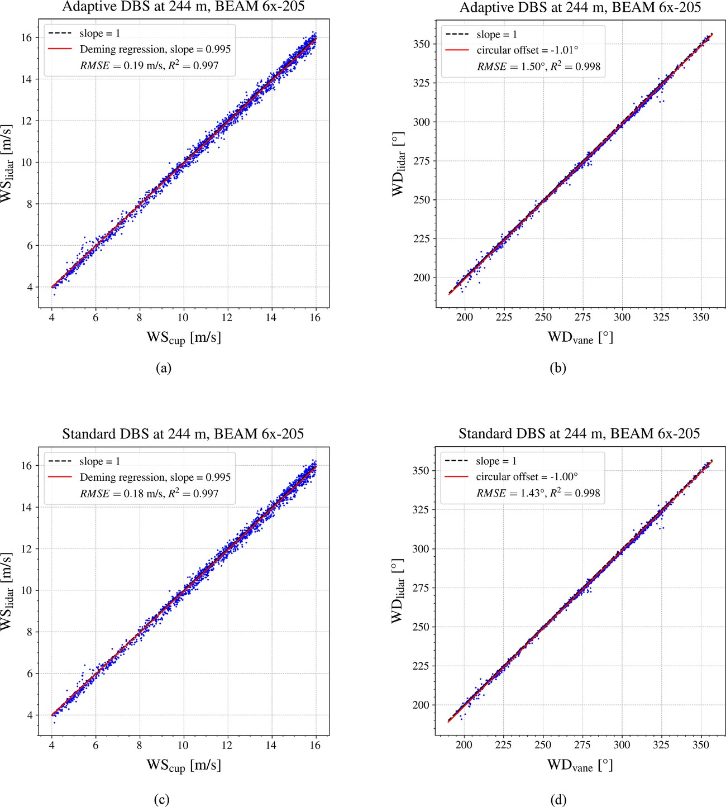

# 六波束多普勒激光雷达：提高高空有效数据率，同时用塔架检验精度

**原文：** M. Manami, G. Léa, J. Mann, M. Sjöholm, and G. Gorju, “Improving wind speed availability of a six-beam Doppler lidar,” *Wind Energy Science*, 11, 585–596 (2026). [DOI / 开放原文](https://doi.org/10.5194/wes-11-585-2026)

## 论文想解决的问题

脉冲式 profiling lidar 通过多个方向的 Doppler 径向速度重建风矢量。传统 DBS 方法在某个斜向波束信噪比不足时，会丢弃整次扫描；高空回波弱，导致有效数据率下降。作者提出 adaptive DBS：只使用信噪比达标、几何条件足够的波束组合重建风矢量。

## 真实现场验证

研究在丹麦 Østerild 大型风机试验场开展两轮观测，使用三台 BEAM 6x profiling lidar，邻近测风塔。第一轮测至 500 m；第二轮两台设备测至约 1 km。作者用测风塔 40、106、178、244 m 的杯式风速计和风向标作为基准，以 10 分钟平均值比较风速和风向。

*原文 Figure 5：244 m、10 分钟平均风速和风向的塔架对比；© Author(s) 2026，CC BY 4.0，Manami et al. (2026)。*

## 主要结果

- 在图示 244 m 高度，adaptive DBS 风速对比的 Deming 回归斜率为 **0.995**，RMSE **0.19 m/s**、R² **0.997**；风向 RMSE **1.50°**。标准 DBS 的对应结果也相近。
- 与标准方法相比，adaptive DBS 在高空提高有效风速数据可用率；三台设备中最高增加 **16.9 个百分点**（接近 980 m 的范围）。
- 这是“维持精度并改善可用率”的现场实证，不代表 1 秒级瞬时风切变同样有 0.19 m/s 的误差：精度图采用 10 分钟平均，切变目标还受到垂直高度差、风场非均匀性和扫描时序的影响。

## 实验自洽性与局限

优点是有两轮现场测量、多个设备、不同高度，并与塔架杯式风速计/风向标直接比较。其结论也比较克制：验证到 244 m 的精度，长距离接近 1 km 的重点结果是有效数据可用率；不同设备的观测时段不完全相同，天气变化和设备差异也可能影响可用率比较。研究地形与海陆条件也不等同于华东沿海风场或机场环境。

## 对我们研究的连接

- 传感器评价不能只有误差，还要同时报告数据覆盖率：切变事件若恰好发生在雷达低信噪比或遮挡时段，较小的 RMSE 并不能代表系统可用。
- 可以借鉴“先固定质量阈值、再比较重建算法”的设计；对 L300 也应把有效距离门、信噪比、遮挡和风向扇区纳入分层分析。
- 参考值应尽量与雷达处在同一高度和相近空气体积。若塔架只有少数高度，不能把插值后的塔架廓线当作无误差真值；要把插值不确定度一并报告。

## 组会可讨论

如果高层风速数据可用率从 79% 提高到 89%，但多用低信噪比波束后误差略升，我们该根据切变告警任务的漏报成本选择哪个配置？
