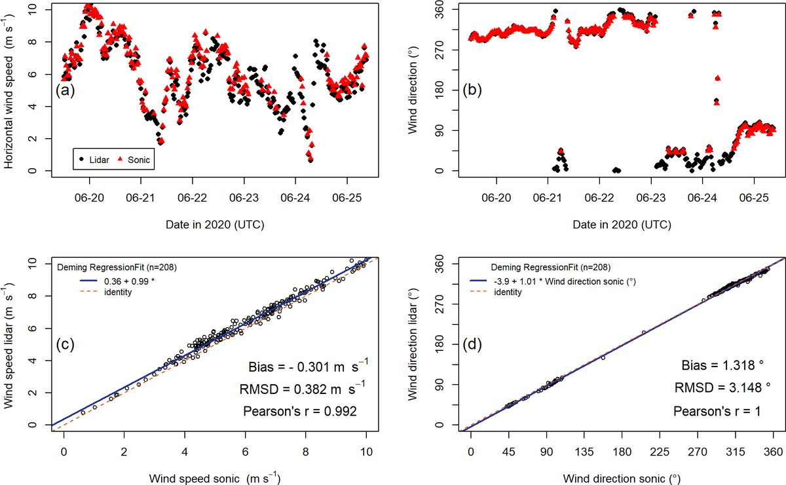

# 多普勒激光雷达与测风塔对比：扫描几何和平均时间决定误差

**原文：** K. Wolz, C. Holst, F. Beyrich, E. Päschke, and M. Mauder, “Comparing triple and single Doppler lidar wind measurements with sonic anemometer data based on a new filter strategy for virtual tower measurements,” *Geoscientific Instrumentation, Methods and Data Systems*, 13, 205–223 (2024). [DOI / 开放原文](https://doi.org/10.5194/gi-13-205-2024)

## 研究问题与现场布设

单台 Doppler lidar 通常通过旋转扫描重建风矢量，需要假设扫描范围内风场近似水平一致。作者把单台 VAD lidar 与三台 lidar 组成的 virtual tower 以及塔架超声风速仪进行比较，以量化扫描角、测量高度和平均时间对风速/风向一致性的影响。

研究在德国 Falkenberg 的边界层观测站开展，覆盖 2020 年 6 月 20 日至 8 月 10 日，约 50 天。三台 lidar 的交汇观测与 99 m 塔架 90 m 高处的 sonic anemometer 对照；两台单 lidar 在不同天顶角下做 VAD 扫描，并比较 90–495 m 多个高度。分析时间尺度包括 2、10、30 分钟。

*原文 Figure 8：上图为 2020 年 6 月的风速/风向时间序列，下图为 lidar 与 sonic 的回归关系；© Author(s) 2024，CC BY 4.0，Wolz et al. (2024)。*

## 主要结果

- 在 90 m、30 分钟平均下，文中不同 lidar 方案与 sonic 的风速可比性指标约 **0.32–0.47 m/s**；相应偏差约 **−0.07 至 −0.34 m/s**。单台 lidar 在合适扫描配置下可以得到可用的平均风速和风向。
- 随测量高度升至约 495 m，一致性变差；单台 VAD lidar 的扫描圆随高度变大，空间非均匀性和扫描几何假设的影响也随之增加。
- 研究强调严谨对齐的必要性：精确 GPS 定位、北向校准、设备水平、跨设备时间同步、range gate 匹配，以及针对信噪比和离群值的筛选。

## 这篇论文如何帮助判断传感器精度

这不是一个“某款 lidar 的通用误差规格”。它给出的数值是在特定平坦场地、特定设备和扫描方式、特定平均时间下，相对于塔架参考仪器的现场差异。把 30 分钟平均的约 0.3–0.5 m/s 直接套到秒级阵风/切变预测，会低估高频误差；把 90 m 的结果直接外推至 300 m 以上也不合适。

塔架也不是绝对无误差真值：塔架结构会扰流，超声风速仪是局地测量，lidar 是一段空气体积的径向速度后重建风矢量。比较时应报告测量高度、时间窗、水平距离、风向扇区、过滤规则、偏差、RMSE/RMSD 和可用率。

## 对我们研究的连接

- mmWave 雷达通常直接提供视线方向的径向速度；要和塔架水平风速比较，先按观测几何做矢量投影或多角度风矢量重建，不能将 radial velocity 与杯式风速计读数直接对比。
- 评估 L300 与 lidar 时，应分别对齐：原始径向速度、重建水平风速/风向、垂直廓线和派生切变。各产品的误差含义不同。
- 对垂直切变，建议同时报告各高度风速误差和层间切变误差；仅有每层风速相关系数高，并不保证两层差分准确。

## 组会可讨论

如果 20 m 和 100 m 的风速都有约 0.3 m/s 随机误差，两个高度的误差会如何传到切变？如果偏差随高度变化，是否会抵消？
